# Chargis (차지스)

> 전기차로 장거리를 갈 때 **"어느 휴게소(또는 충전소)에서, 몇 %까지, 얼마 동안"** 충전하면 되는지 차량 화면이 먼저 알려 주는 Pleos Connect용 장거리 충전 비서 앱

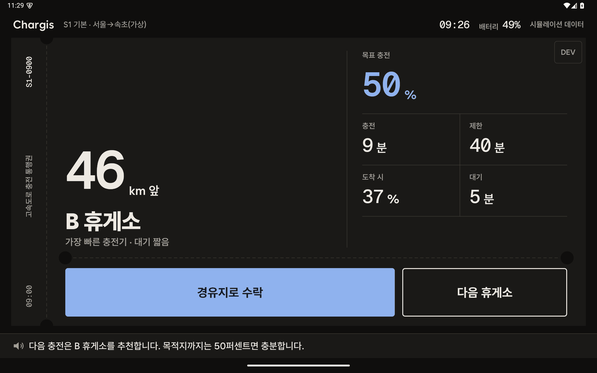

현대자동차그룹 차량용 앱 개발 공모전 출품작입니다. 내비게이션 경로와 배터리 상태를 읽어 경로상 충전소 가운데 1순위를 고르고, 목적지까지 필요한 만큼만 충전하라고 안내합니다. 기본은 고속도로 휴게소이고, 졸음쉼터와 국도변·IC 근처·상업시설·공공시설 충전소도 대안 후보로 함께 비교합니다. 충전기 시간 제한까지 챙겨 주므로 충전이 중간에 끊기지 않습니다.

> 충전소 추천과 도착 배터리 예측은 이미 여러 EV 내비가 합니다. Chargis는 그 경로 위에서 **몇 %까지, 얼마 동안** 충전할지와 **충전기 시간 제한**까지 챙기는 비서입니다.

---

## 왜 만들었나

명절이나 주말에 고속도로로 장거리를 가는 전기차 운전자는 매번 같은 고민을 합니다.

| 문제 | Chargis의 답 |
|---|---|
| 휴게소 충전기가 붐벼서 기다려야 한다 | 출력, 가용 대수, 예상 대기를 함께 비교해 **덜 붐비는 휴게소**를 고르고, 휴게소가 모두 붐비면 **조금 벗어난 국도변·마트 충전소**까지 왕복 우회를 넣어 비교한다 |
| 시간 제한을 몰라서 충전이 중간에 끊긴다 | 충전을 시작할 때 **운영 규칙을 안내**하고, 제한 안에 목표에 닿을 수 있는지 미리 계산한다 |
| 몇 %까지 충전할지 판단하기 어렵다 | 목적지까지 필요한 에너지에 안전 마진을 더해 **"OO%까지만 충전"** 이라고 정해 준다 |
| 동승자가 언제 출발하는지 모른다 | 충전 화면에 **목표까지 남은 시간과 출발 예정 시각**을 크게 띄운다 |

---

## 기존 내비와 무엇이 다른가

경로상 충전소 추천, 도착 시 배터리 예측, 충전소 경유지 추가는 순정 EV 경로 플래너, 티맵 오토, Google Maps, Tesla 내비 같은 여러 내비가 이미 제공합니다. Chargis는 이 기능들을 다시 만드는 앱이 아닙니다. 내비가 짠 경로 위에서 **얼마나, 얼마 동안 충전할지**를 판단해 주는 비서 앱입니다.

| | 기존 EV 내비 | Chargis |
|---|---|---|
| 충전 목표 | 정차 지점과 충전 시간을 보여 주거나, 도착 잔량을 사용자가 정한다 | 목적지까지 필요한 에너지에 안전 마진을 더해 **"50%까지 충전"처럼 목표를 계산해 준다** |
| 충전기 시간 제한 | 다루지 않는다 | 제한 안에 목표에 닿는지 미리 계산하고, 못 닿으면 **10분·5분 전에 경고**하고, 끊기면 **다음 충전소를 다시 추천**한다 |
| 충전 중 화면 | 따로 없거나 차량 충전 메뉴에 맡긴다 | 목표까지·제한까지 남은 시간과 **출발 예정 시각**을 동승자도 읽게 크게 띄운다 |
| 혼잡할 때 | 자동으로 다른 충전소로 바꾸거나 사용 현황만 보여 준다 | **대기 시간 vs 도착 시 배터리**를 나란히 비교하고 운전자가 고른다 |
| 대상 | 모든 충전소 | **고속도로 장거리 이동**에 맞췄다. 휴게소·졸음쉼터를 먼저 고르고, 경로를 벗어나는 충전소는 **왕복 우회와 진출입 시간까지 셈해 확실히 나을 때만** 권한다 |
| 주행 중 안내 | 경로 안내 위주 | 충전소마다 한 번만 안내하고, 거절한 곳은 다시 말하지 않고, 버튼은 2개만 둔다 |
| 정보가 없을 때 | 표시 방식이 제각각이다 | 숨기지 않고 **"정보 없음"과 데이터 출처**를 표시한다 |
| 겨울·산길 | 차종마다 다르다 | 차가운 배터리의 느린 충전과 **예열 효과**, 오르막·내리막 에너지를 목표 충전량과 충전 시간에 넣는다 |

Chargis는 경로 안내를 기존 내비에 맡기고(`NaviPort`), 충전 판단만 맡습니다. 그래서 순정 내비와 경쟁하지 않고 그 위에서 함께 동작합니다.

**하지 않는 것:** 충전 결제·적립, 충전기 예약, 지도에서 충전소 찾기와 리뷰, 대리 충전은 충전 앱과 지도 앱의 영역이라 넣지 않았습니다. 요금은 보여 주지만 순위에는 넣지 않고(기준은 목적지 도착 시각), "아낀 돈"은 표시하지 않습니다. 고속도로에서 덜 채운 전기는 결국 다른 곳에서 채우기 때문입니다.

> 비교는 2026년 10월에 공개 자료로 조사한 내용이며, 차종·버전·지역에 따라 다를 수 있습니다.

---

## 핵심 기능

| ID | 기능 | 설명 | 현재 상태 |
|---|---|---|---|
| F1 | 경로상 충전소 추천 | 경로상 충전소마다 주행(왕복 우회 포함)·도착 시각 기준 예상 대기·충전·들르는 시간을 더해 **목적지에 가장 빨리 도착하는 곳**을 1순위로, 대안 2곳과 함께 고른다. 한 번으로 못 가면 두 번째 충전소까지 계획한다. 후보는 고속도로 휴게소, 졸음쉼터, 국도 휴게소, 국도변·IC 근처 충전소, 상업·공공시설이며 휴게소·쉼터가 먼저다 | ✅ 구현 |
| F2 | 목표 충전량 코치 | 목적지(또는 다음 충전소)까지 필요한 SoC에 안전 마진을 더하고 5% 단위로 올려 "50%까지 충전"처럼 안내한다. 경로를 벗어난 충전소면 경로로 돌아오는 거리까지 채운다. 소비는 기온과 실측 전비로 보정하고, 충전 중에 ±5%로 바꿀 수 있다 | ✅ 구현 |
| F3 | 충전 시간 제한 알림 | 충전을 시작하면 "40분 제한"(데모 시나리오 값) 같은 운영 규칙을 안내하고, 목표까지·제한까지 남은 시간과 출발 예정 시각을 보여 준다. 제한 안에 목표에 못 닿으면 10분·5분 전에 "종료 시 약 N%"를 경고하고, 제한으로 끝나면 다음 충전소를 다시 추천한다. 곧 목표에 닿으면 5분 전에 이동 준비를 알린다 | ✅ 구현 (충전 시작은 버튼, 충전 중 SoC는 시뮬레이터 값) |
| F4 | 경유지 자동 추가 | 추천을 수락하면 해당 충전소를 내비게이션 경유지로 등록하고 경로를 다시 탐색한다 | 🟢 데모 경로 + Pleos 순정 내비에 실제 경유지 추가(NaviHelper, 두 자리가 차 있으면 안내) |

이 밖에 다음 기능을 함께 제공합니다.

- **혼잡 대안 비교:** 1순위 휴게소의 대기 시간이 20분을 넘으면, 대안 충전소와 "대기 시간 vs 도착 시 배터리"를 나란히 비교하는 카드를 띄웁니다.
- **휴게소 밖 충전소:** 졸음쉼터, 국도변·IC 근처, 마트·주유소 같은 상업시설, 공영주차장 같은 공공시설 충전소도 후보입니다. 경로를 벗어나는 곳은 **갔다 오는 거리(왕복)와 IC 진출입 시간(5분, 가정)** 을 도착 시각에 넣고, 휴게소·쉼터가 아니면 순위에 5분을 더해 휴게소를 먼저 고릅니다. 이용 가능 시간을 아는 곳은 도착할 때 닫혀 있거나 30분 안에 닫으면 뺍니다. 카드에는 이름 아래에 *"상업시설 · 왕복 5km 우회 · 10:00~22:00 운영"* 처럼 한 줄을 덧붙이고, 음성으로 *"I 마트, 경로를 벗어나 왕복 약 5킬로미터를 더 달립니다"* 라고 알립니다. 도심처럼 이런 충전소가 많은 구간에서는 20km마다 우회가 짧고 출력이 큰 2곳만 비교합니다. 휴게소만 보고 싶으면 설정의 **충전소 범위 → 휴게소·쉼터만**으로 끕니다.
- **경유지 변경 안내:** 수락한 곳보다 5분 넘게 빨리 도착하는 곳이 생겨 경유지를 바꾸면, 이전 경유지를 지우고 *"경유지를 바꿨습니다. B 휴게소 대신 C 휴게소. 목적지에 약 7분 빨리 도착합니다"* 처럼 이유를 말합니다.
- **시간 제한 정보 없음:** 제한이 없다고 확인한 충전기는 "없음", 확인하지 못한 충전기는 **"정보 없음"** 으로 나눠 표시하고, 충전을 시작하면 *"이 충전기의 시간 제한 정보가 없습니다. 충전기 화면에서 확인해 주세요"* 라고 알립니다.
- **이용 제한 충전소 제외:** 아파트·사업장·학교처럼 외부인이 쓰기 어려운 시설과 "입주민 외 이용불가" 같은 이용자 제한이 걸린 충전기는 후보에서 뺍니다.
- **음성 안내와 음성 명령:** 모든 안내에 음성을 함께 내고 화면 아래에 자막으로도 보여 줍니다. 같은 문장은 반복하지 않고, 이미 안내했거나 거절한 충전소도 다시 안내하지 않습니다. Pleos 차량에서는 **Pleos TextToSpeech SDK**로 차량 오디오에 말하고, 설정에서 음성 명령을 켜면 **Pleos SpeechToText SDK**로 "수락", "다음", "충전 시작", "출발", "예열"을 알아듣습니다. 둘 다 차량 안의 On-device 엔진을 써서 네트워크가 없어도 됩니다. Pleos가 아닌 기기에서는 안드로이드 기본 엔진을 씁니다.
- **출처 표시:** 실시간 정보가 없으면 숨기지 않고 "정보 없음"으로 표시하고, 화면 상단에 데이터 출처(시뮬레이션, 직접 입력, 차량 데이터)를 표시합니다.
- **충전구 호환:** 차종의 충전구(기본 DC콤보)를 꽂을 수 없는 충전기는 후보에서 빼고, 빈 대수와 출력도 꽂을 수 있는 충전기만 셉니다. 충전구를 모르면 거르지 않습니다.
- **차가운 배터리와 예열:** 배터리가 차가우면 충전을 덜 받는 만큼 충전 시간을 늘려 잡습니다(20°C 이상 제 속도, -10°C 이하 25%, 가정). 수락한 충전소에서 3분 넘게 늦어질 것 같으면 도착 30분 전에 *"지금 배터리 예열을 켜면 충전이 약 N분 빨라집니다"* 라고 권하고, 앱에서 예열을 켤 수 있는 차량이면 경유지 안내 카드에 **[배터리 예열 켜기]** 를 띄웁니다(음성으로 "예열"이라고 말해도 됩니다). Pleos Vehicle SDK에는 예열 제어가 없어(차량 제어 SDK 준비 중) 실차에서는 버튼 없이 *"차량 화면에서 배터리 예열을 켜면 충전이 약 N분 빨라집니다"* 라고만 안내합니다. 데모 시뮬레이터 차량은 앱에서 켤 수 있습니다.
- **충전 요금:** 도착·충전 완료 화면에 예상 요금과 이번 요금을, 정산 영수증에 충전마다의 요금과 합계를 찍습니다. 요금을 모르는 충전소는 "정보 없음"입니다. 순위에는 넣지 않습니다.
- **목적지 도착 잔량:** 설정에서 목적지에 남길 배터리(10·20·30%)를 고릅니다. 목적지에 충전기가 없을 때 쓰며, 충전소에 도착할 때 남길 최소 잔량(10%)과는 따로입니다.
- **고장 의심 충전소:** 운영중지·점검 중인 충전기는 "고장·점검 N대"로 알리고, 고속도로 휴게소·상업시설은 72시간, 이용이 드문 쉼터·공공시설 등은 일주일 넘게 아무도 충전하지 못했으면 *"3일째 충전 기록 없음"* 을 붙이고 순위를 10분 낮춥니다. 쓸 수 있는 충전기가 하나도 없으면 후보에서 뺍니다.
- **오르막·내리막:** 내비 경로에 고도가 있으면 오르막에서 더 쓰고 내리막에서 일부 되찾는 배터리를 목표 충전량에 넣습니다. 고개를 앞둔 충전소에서는 평지보다 더 채우라고 합니다.
- **배터리 직접 입력:** 차량에서 배터리 %를 받을 수 없거나 설정에서 **배터리 값 → 직접 입력** 을 고르면, 출발 배터리에서 달린 거리·고도·충전 곡선으로 이어 계산합니다. 충전소에 도착하면 계기판 값을 확인해 달라고 하고, 정차 화면의 **[맞음] [−5] [−1] [+1] [+5]** 로 확인하거나 고치면 그 값부터 다시 이어 가고 전비 보정에도 씁니다.

---

## 디자인: 통행권

Chargis의 화면은 **고속도로 통행권 한 장**을 모델로 했습니다. 출발할 때 표를 발권하고, 충전하는 곳마다 절취선이 있는 칸을 찍고, 도착하면 정산 영수증을 받습니다.

- **표 용지와 잉크:** 야간(기본)은 따뜻한 차콜 용지에 흰 잉크, 주간은 차가운 흰 감열지에 검은 잉크입니다. 시스템의 야간 모드를 따라 자동으로 바뀝니다.
- **도장 잉크 한 가지:** 코발트색은 지금 향하는 충전소, 충전소를 표에 찍는 동작(경유지로 수락), 도장에만 씁니다. 경고는 호박색이며 늘 그린 기호와 글자를 함께 씁니다.
- **글꼴:** 한글은 [Wanted Sans](https://github.com/wanteddev/wanted-sans), 거리·%·분·시각 같은 측정값은 [Geist Mono](https://github.com/vercel/geist-font)를 씁니다. 둘 다 SIL Open Font License 1.1이며 라이선스 전문은 [docs/licenses/](docs/licenses/)에 있습니다.
- **카드·그림자·이모지 없음:** 칸은 1dp 괘선으로만 나누고, 아이콘은 Compose로 직접 그렸습니다.
- **움직임은 최소로:** 주행 중에는 화면이 계속 움직이지 않습니다. 카드가 바뀔 때의 짧은 전환과 도장이 찍히는 순간만 움직이고, 기기에서 "애니메이션 제거"를 켜면 그것도 없앱니다.

디자인 결정은 [DESIGN.md](DESIGN.md)에, 제품 기준은 [PRODUCT.md](PRODUCT.md)에 정리했습니다.

---

## 실제 사용 화면

아래 화면은 앱에 들어 있는 데모 시나리오를 실행하며 캡처했습니다. 기본 흐름은 **S1(가상의 서울→속초, 출발 배터리 60%, 210km)** 이고, 혼잡은 S2, 충전 시간 제한은 S3, 겨울과 배터리 예열은 S4, 휴게소 밖 충전소는 S5, 산길은 S6입니다.

> 모든 화면은 2026-10-25 기준 앱으로 다시 찍었습니다. 일반 Android 에뮬레이터(태블릿, 가로 2560×1600)를 썼고, 08·11·17번만 주간 모드이고 나머지는 야간 모드입니다. 오른쪽 위의 작은 `DEV` 꼬리표는 데모 진행용 개발자 오버레이이며 릴리스 빌드에서는 보이지 않습니다. 시연 속도를 높이느라 개발자 오버레이로 배속을 올리거나 건너뛴 화면이 있어, 안내 시점의 거리(예: "23km 앞")는 장면마다 다릅니다. 충전소 이름, 요금, "제한 40분" 같은 값은 모두 데모용 가정값이며 실제 운영사·기기마다 다릅니다.

### 1. 발권 → 출발

| 발권 화면 | 내 차 설정 |
|---|---|
| 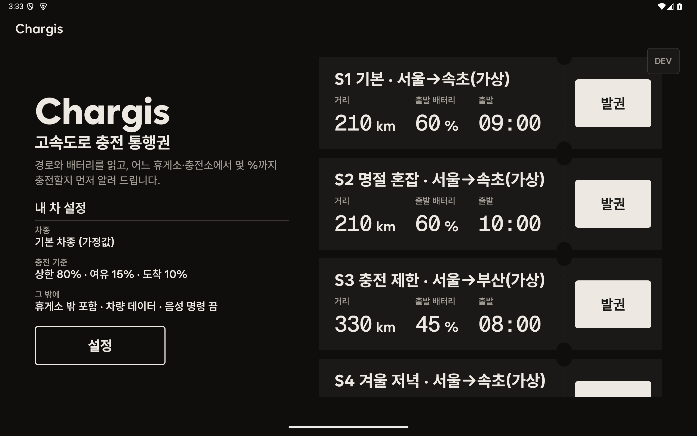 | 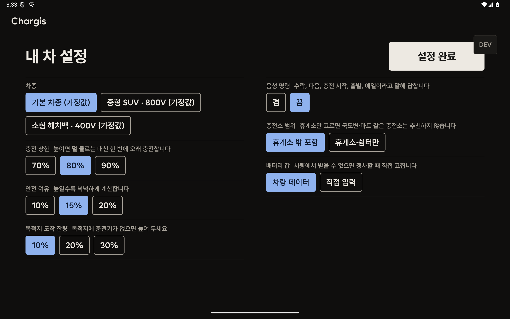 |
| 시나리오마다 통행권이 한 장씩 있습니다. 왼쪽에는 **내 차 설정** 요약(차종 / 상한·여유·도착 잔량 / 충전소 범위·배터리 값·음성 명령)과 [설정] 버튼이 있습니다. | [설정]을 누르면 두 칸으로 나뉜 설정 화면이 열립니다. 왼쪽은 충전 계산 기준(차종, 충전 상한, 안전 여유, 목적지 도착 잔량), 오른쪽은 앱 동작(음성 명령, 충전소 범위, 배터리 값)입니다. 고른 값은 기기에 저장되고 다음 발권부터 적용됩니다. |

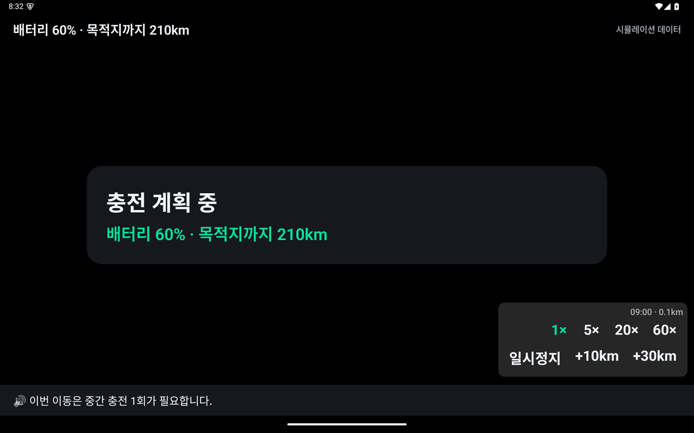

출발하면 *"이번 이동은 중간 충전 1회가 필요합니다"* 라고 안내합니다. 표에는 구간 띠, 남은 거리, 충전 예정 휴게소와 거리, 목표 충전량, 충전 시간, 도착 예정 시각이 인쇄됩니다.

### 2. 주행 중 추천 → 수락 (F1·F2·F4)

| 추천 | 경유지 안내 중 |
|---|---|
|  | 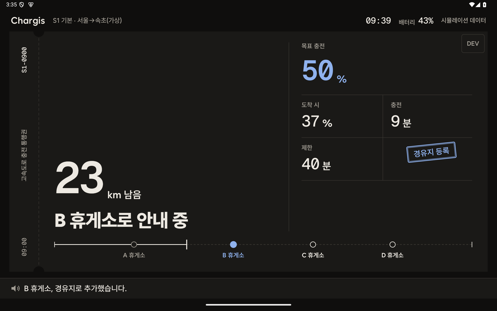 |
| 1순위 충전소가 50km 안에 들어오면 한 번만 안내합니다. 왼쪽에는 거리 하나를 크게 두고, 추천 이유를 **도장 꼬리표**("다음 후보보다 7분 빠름")로 찍습니다. 오른쪽에는 목표 충전량과 목적지 도착 시각, 충전·대기·도착 배터리·제한을 인쇄합니다. 제한 칸은 위험이 없으면 흐리게, 위험하면 경고색과 기호로 올립니다. 주행 중에는 **큰 버튼 2개(경유지로 수락 / 다음 충전소)** 만 누를 수 있습니다. | [경유지로 수락]을 누르면 표에 **"경유지 등록" 도장**이 찍히고, 자막으로 *"B 휴게소, 경유지로 추가했습니다"* 가 뜹니다. |

### 3. 도착 → 충전 (F3)

| 휴게소 도착 | 충전 중 |
|---|---|
| 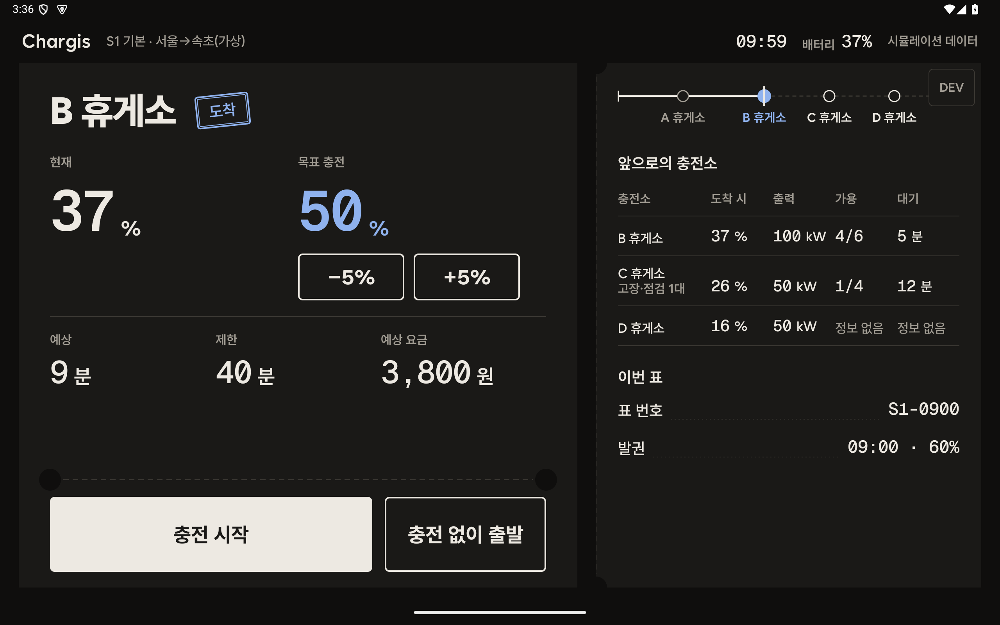 | 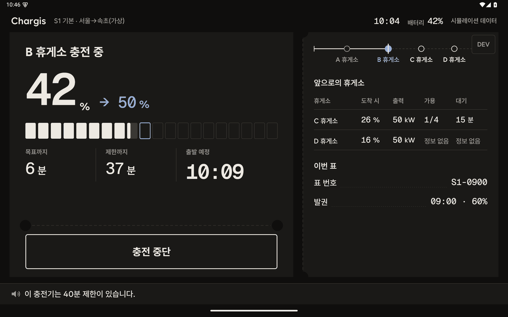 |
| 정차하면 바로 상세 화면으로 바뀝니다. 예상 충전 시간, 시간 제한, **예상 요금**을 인쇄하고, 오른쪽 표에는 앞으로의 충전소 비교(고장·점검 중인 충전기 수 포함)와 지금까지 이 표에 찍힌 내용이 인쇄됩니다. | 지금 배터리 숫자 하나가 화면의 주인입니다. 5% 단위 칸 막대와 함께 **목표까지·제한까지 남은 시간, 출발 예정 시각**을 동승자도 읽을 수 있게 크게 보여 줍니다. **[−5%] [+5%]** 로 목표를 바꾸면 출발 시각과 경고가 다시 계산되고, 아래 **출력 곡선**에 이번에 채울 구간과 지금 들어오는 kW가 보입니다. |

### 4. 충전 완료 → 정산 영수증

| 충전 완료 | 목적지 도착: 정산 영수증 |
|---|---|
| 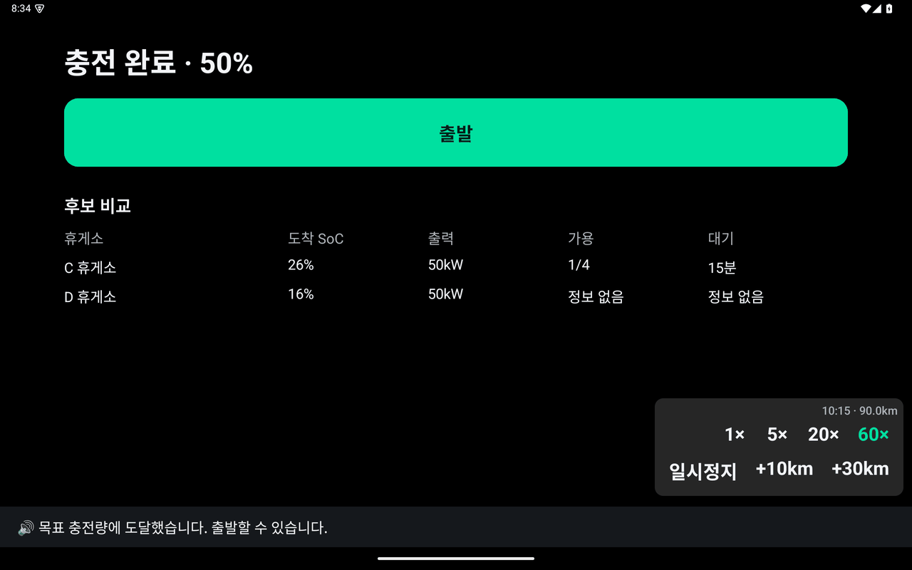 | 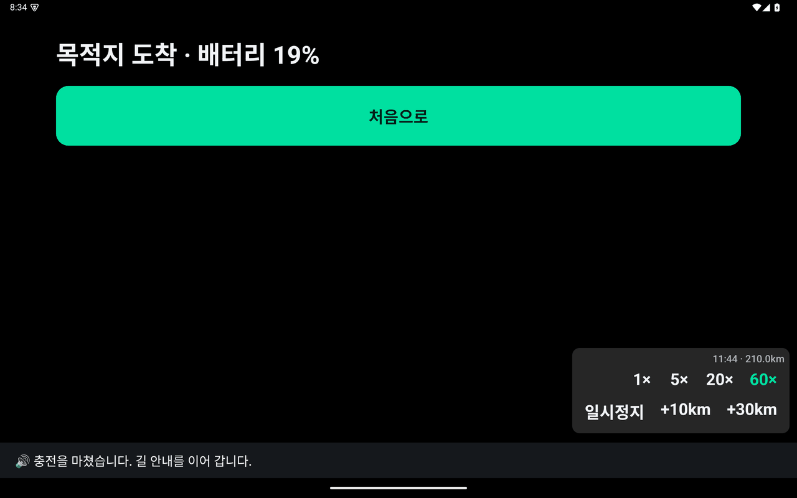 |
| 목표에 도달하면 "충전 완료" 도장을 찍고 **이번 요금**과 [출발] 버튼을 띄웁니다. | 도착하면 출발·충전(요금은 아래 줄에)·도착 기록이 담긴 **정산 영수증**을 인쇄합니다. 습관처럼 80%까지 채웠을 때와 비교해 **아낀 시간**(이 예에서 18분)과 **충전 요금** 합계를 보여 줍니다. |

### 5. 명절 혼잡 (S2)

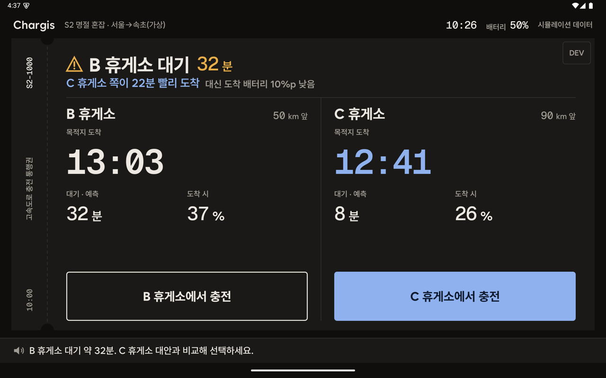

붐비지 않았다면 골랐을 B 휴게소의 대기가 길면 표를 세로 괘선으로 나눠 대안인 C 휴게소와 비교합니다. 운전자가 실제로 궁금한 **목적지 도착 시각**을 가장 크게 인쇄하고, 맨 위에 *"C 휴게소 쪽이 21분 빨리 도착 · 대신 도착 배터리 10%p 낮음"* 한 줄로 판정과 대가를 함께 적습니다. 대기는 지금 값이 아니라 **도착할 때의 예측**(실시간 + 시간대별 통계)입니다. 버튼에는 휴게소 이름이 들어가서 음성이나 화면 낭독기로도 구분할 수 있습니다.

### 6. 충전 시간 제한 (S3, F3)

가상의 서울→부산 330km를 배터리 45%로 출발하는 시나리오입니다. 한 번 충전으로는 목적지까지 못 가므로, 엔진이 **두 번 들르는 계획**을 세웁니다. 느린 E 휴게소(25kW)에서는 빠른 F 휴게소까지 갈 만큼(45%)만 채우고, F에서 55%까지 채우는 쪽이 가장 빨리 도착합니다. 다만 E 충전기의 40분 제한(데모 시나리오 값) 안에는 45%에도 닿지 못합니다.

| 추천: 제한 위험 미리 알림 | 충전 중: 제한 경고 |
|---|---|
| 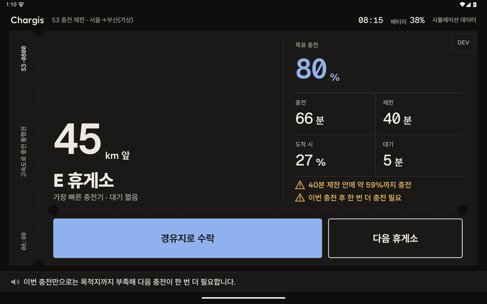 | 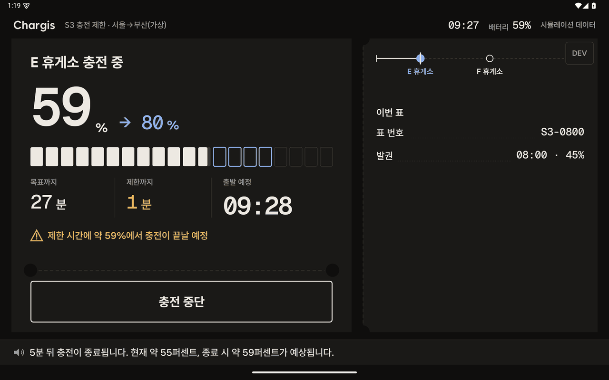 |
| 수락하기 전부터 "40분 제한 안에 약 43%까지"를 경고하고, 두 번째 충전 계획(F 휴게소 55%)을 함께 보여 줍니다. | 목표까지 걸릴 시간이 제한보다 길면 *"제한 시간에 약 43%에서 충전이 끝날 예정"* 을 띄우고, 제한 10분 전과 5분 전에 *"5분 뒤 충전이 종료됩니다. 종료 시 약 43퍼센트가 예상됩니다"* 라고 알립니다. |

| 제한 종료 | 다음 휴게소 재추천 | 정산 영수증 |
|---|---|---|
| 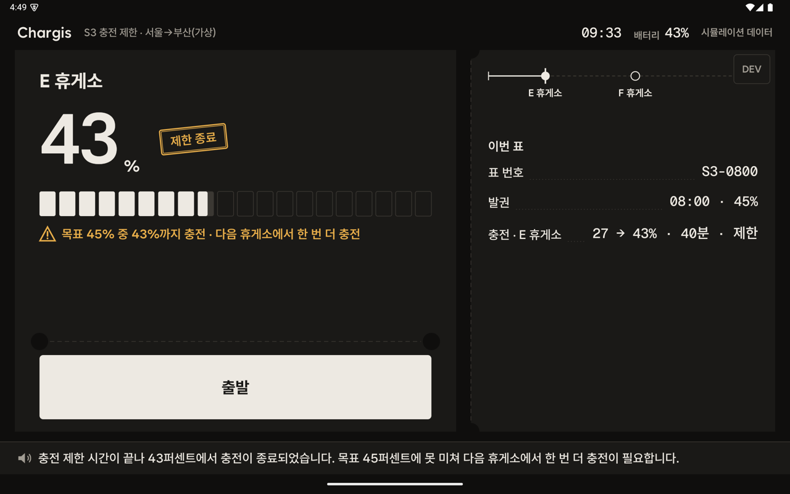 | 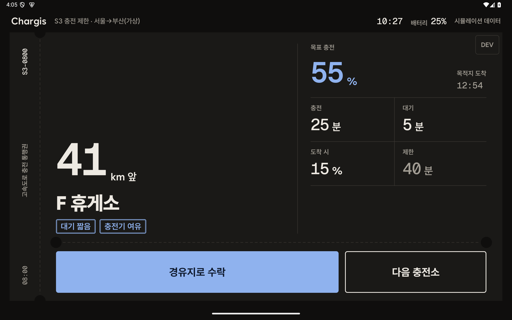 | 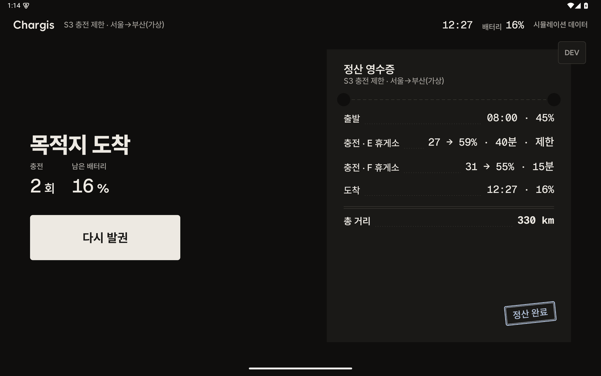 |
| 제한 시각에 충전기가 끊기면 "제한 종료" 도장과 함께 목표에 못 미친 만큼을 알려 줍니다. | 다시 출발하면 남은 배터리로 다음 충전지를 계산해 F 휴게소를 추천합니다. | 영수증에 제한으로 끝난 충전이 "제한"으로 남고, 충전마다 요금이 찍힙니다. |

### 7. 겨울 저녁 (S4): 실측 전비 보정과 배터리 예열

| 실측 전비 보정 (주간) | 배터리 예열 안내 |
|---|---|
| 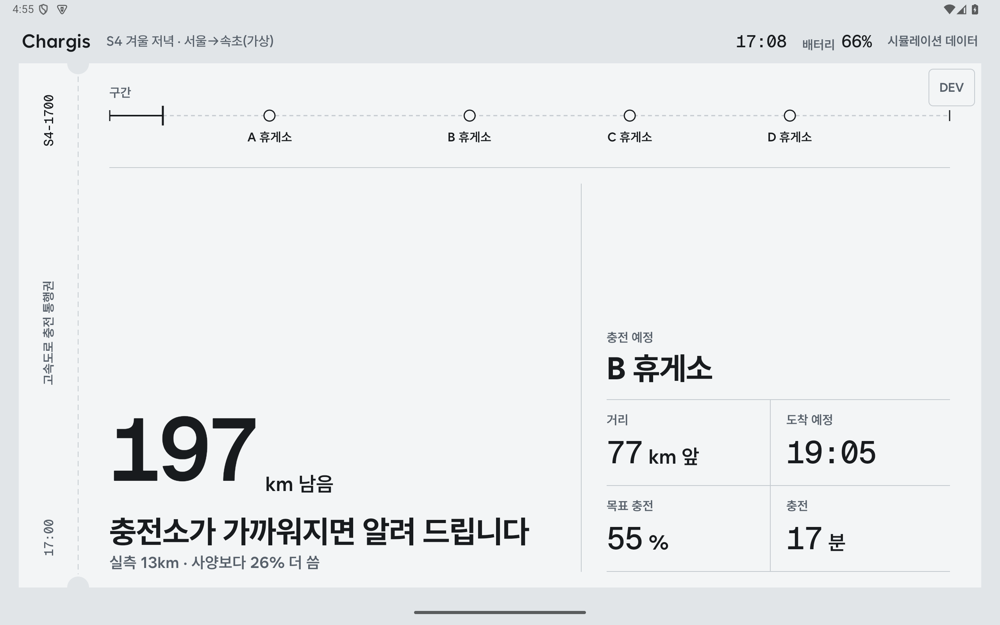 | 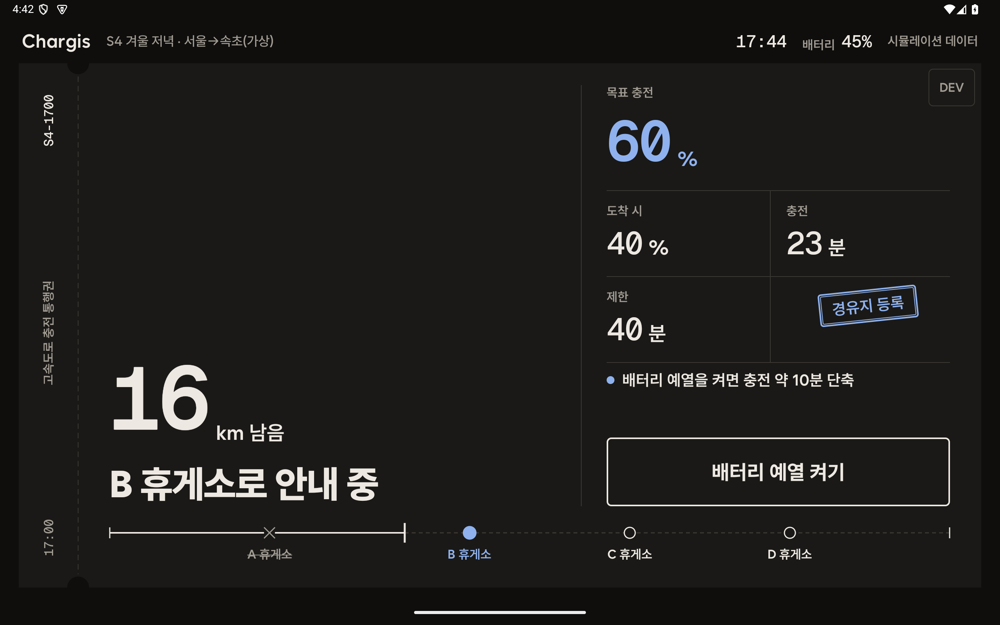 |
| 영하 8°C 저녁에 출발합니다. 가상 차량은 사양보다 30% 더 쓰지만 앱은 그 사실을 모릅니다. 출발 직후에는 기온으로 어림한 값(+18%)을 쓰고, 달리면서 실제로 1km에 몇 %씩 줄었는지 재어 사양보다 더 쓴다는 것을 알아냅니다. 보정된 소비로 목표 충전량을 다시 계산하므로 휴게소에 도착했을 때 배터리가 안내와 크게 다르지 않습니다. | 배터리도 차가워 100kW 충전기에서 충전을 덜 받습니다. 수락한 B 휴게소 도착 30분 전에 *"지금 배터리 예열을 켜면 충전이 약 10분 빨라집니다"* 라고 권하고 **[배터리 예열 켜기]** 버튼을 띄웁니다. "예열"이라고 말해도 켜집니다(데모 차량). 앱에서 켤 수 없는 차량이면 버튼 없이 차량 화면에서 켜 달라고 안내합니다. |

### 8. 휴게소 밖 충전 (S5)

가상의 서울→속초 210km를 배터리 55%로 출발하는 시나리오입니다. 경로 위의 G 휴게소(대기 35분)와 H 졸음쉼터(대기 25분)는 붐비고, 100km 지점에서 경로를 2.5km 벗어난 I 마트(200kW, 8대 중 5대 빔, 10:00~22:00 운영)는 비어 있습니다.

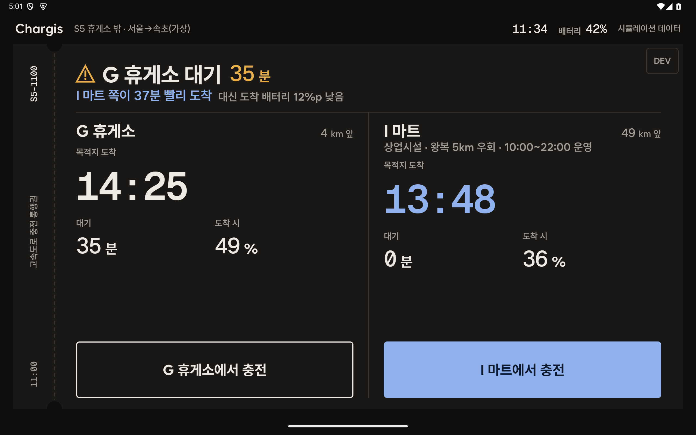

1. 출발해서 그대로 달리면 **I 마트를 1순위로 추천**합니다. 왕복 5km와 IC 진출입 시간, 휴게소가 아니라서 붙는 순위 가산 5분을 모두 넣고도 붐비는 휴게소·쉼터보다 목적지에 빨리 도착하기 때문입니다. 음성은 추천 문구 다음에 *"I 마트, 경로를 벗어나 왕복 약 5킬로미터를 더 달립니다"* 라고 덧붙입니다.
2. 위 화면은 개발자 오버레이로 50km 지점까지 건너뛰어, G 휴게소가 4km 앞에 있을 때 본 것입니다. 붐비지 않았다면 골랐을 G 휴게소(대기 35분)를 왼쪽에, I 마트를 오른쪽 대안으로 나란히 인쇄하고, 마트 이름 아래에 종류·왕복 우회·운영 시간을 한 줄로 붙입니다.
3. 마트를 고르면 시뮬레이터도 경로에서 마트까지 2.5km를 더 달려 배터리를 쓰고, 출발할 때 경로로 돌아오는 2.5km를 다시 씁니다. 그래서 도착했을 때 배터리가 안내한 값과 맞습니다.

### 9. 산길 (S6): 오르막·내리막

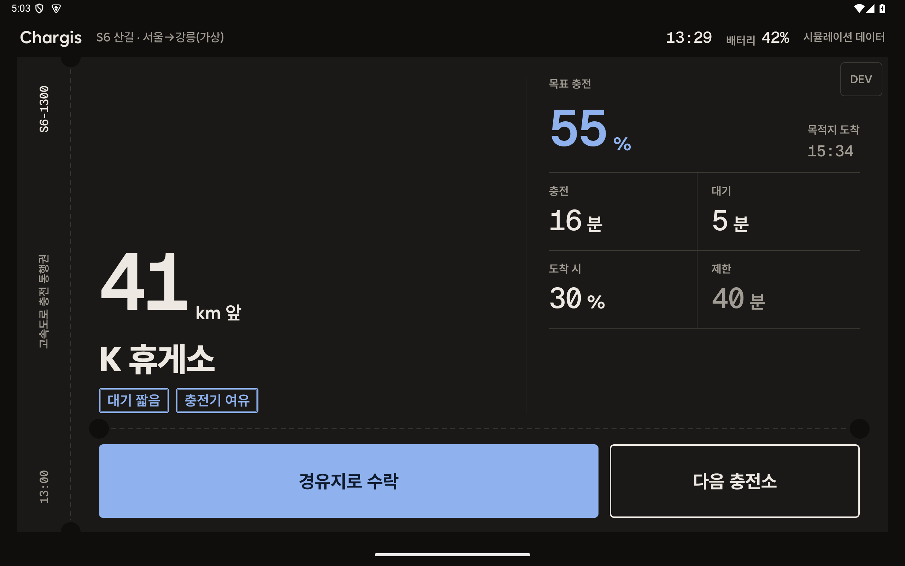

가상의 서울→강릉 220km를 배터리 55%로 출발합니다. 180km 부근에서 해발 780m 고개를 넘어 바닷가로 내려갑니다. K 휴게소에서 남은 130km만 보면 50%면 되지만, 오르막에 더 쓰고 내리막에서 일부만 되찾는 몫을 넣어 **55%까지 채우라고** 합니다. 가상 차량도 같은 고도를 달리므로 도착 배터리가 안내와 맞고, 전비 보정은 오르막을 "전비가 나쁘다"로 오해하지 않습니다.

### 10. 배터리 직접 입력

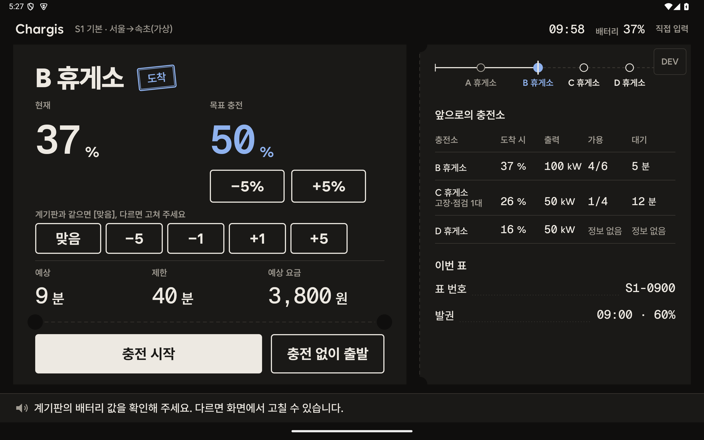

차량에서 배터리 %를 받을 수 없거나 설정에서 **배터리 값 → 직접 입력** 을 고르면, 머리 줄의 출처가 "직접 입력"으로 바뀌고 앱이 거리·고도·충전 곡선으로 배터리를 이어 계산합니다. 충전소에 도착하면 *"계기판의 배터리 값을 확인해 주세요"* 라고 말하고, **[맞음] [−5] [−1] [+1] [+5]** 로 확인하거나 고치게 합니다. 확인한 값은 전비 보정에도 쓰여 다음 추정이 정확해집니다.

### 11. 주간 모드

| 추천 (주간) | 충전 중 (주간) |
|---|---|
| 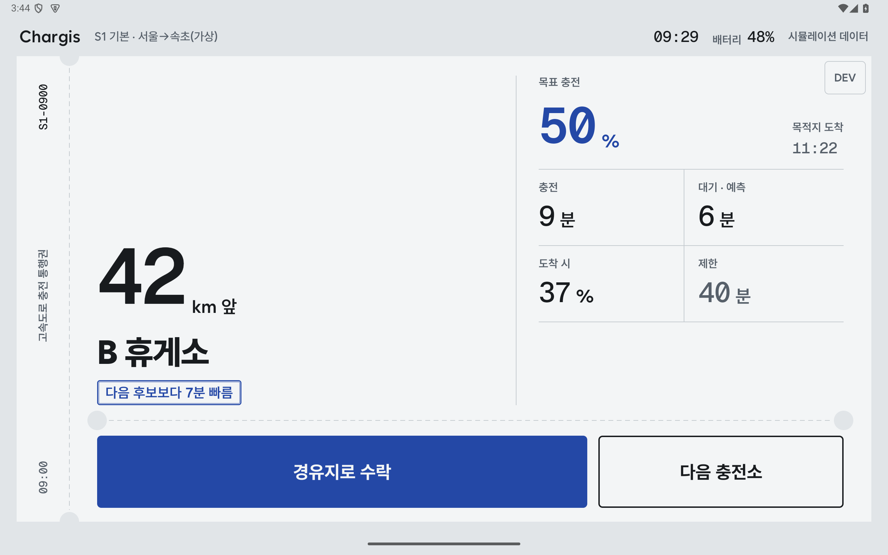 | 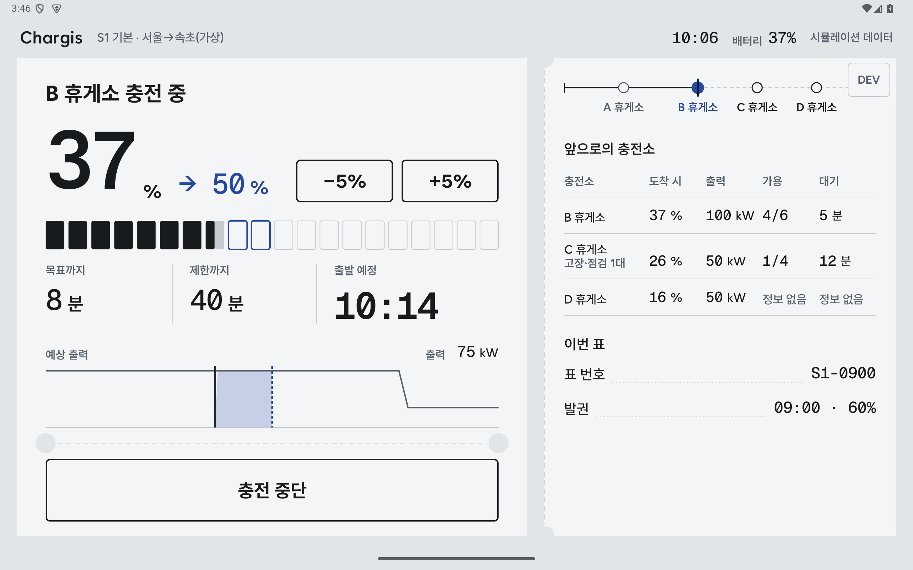 |

시스템의 야간 모드를 따라 자동으로 바뀝니다.

---

## 어떻게 계산하나

추천 엔진은 안드로이드 의존이 없는 순수 Kotlin 코드이며([`ChargeMath`](app/src/main/java/com/chargis/app/domain/engine/ChargeMath.kt), [`RecommendationEngine`](app/src/main/java/com/chargis/app/domain/engine/RecommendationEngine.kt)), 단위 테스트로 검증합니다.

```
socPerKm          = (1 / 전비) / 배터리 용량 × 100              // 1km당 쓰는 배터리 %
도착 SoC          = 현재 SoC − 거리 × socPerKm
필요 SoC(거리)    = 거리 × socPerKm × (1 + 안전 마진 15%) + 최소 도착 잔량 10%
목표 충전량       = 필요 SoC를 5% 단위로 올림 (상한 80%)
충전 시간         = 차종 충전 곡선이 있으면 SoC 0.25%씩 실제 출력으로 적분, 없으면 80% 이하 × 0.75 / 초과 × 0.35
소비 배율         = 기온·속도로 어림한 값에서 시작해 실측(최근 40km)으로 옮겨 감 → 전비 ÷ 배율
도착 시 대기      = 실시간 대기 × w + 시간대별 통계 × (1 − w),  w = 0.5^(도착까지 분 ÷ 45)
도착 SoC(충전소)  = 현재 SoC − (경로상 거리 + 편도 우회) × socPerKm − 고도 몫(오르막 ÷ 0.9, 내리막 × 0.6)
필요 SoC(충전 후) = 필요 SoC(편도 우회 + 남은 경로)                // 경로로 돌아오는 거리까지 채운다
목적지 도착(분)   = 주행(남은 경로 + 왕복 우회) + 예상 대기 + 충전 + 들르는 시간 3분
                    [+ 경로를 0.5km 넘게 벗어나면 진출입 5분] [+ 두 번째 충전소 몫]
충전 시간(차가울 때) = 차의 수용 출력 × 온도 배율(20°C 1.0 ~ -10°C 0.25)로 다시 적분 // 충전기 출력은 그대로
요금              = (목표 − 도착 SoC) × 배터리 용량 × 충전 손실 1.08 × 단가(원/kWh)
순위              = 목적지 도착 + 위험 가산(도착 잔량 20% 미만, 시간 제한 위험, 72시간 무충전 10분)
                    + 휴게소·쉼터가 아니면 5분 이 가장 작은 계획
```

한 번 충전으로 목적지까지 못 가면, 뒤 충전소마다 첫 충전소 목표를 5%씩 바꿔 보며 **두 번 들르는 계획 중 가장 빨리 도착하는 조합**을 고릅니다. 느린 충전기에서는 덜, 빠른 충전기에서는 더 채우게 됩니다.

이용 가능 시간을 아는 충전소는 도착 시각부터 30분 동안 열려 있어야 후보로 둡니다. 모르면 열려 있다고 보고 화면에 시간을 표시하지 않습니다.

기본 차종 프로필(77.4kWh, 5.0km/kWh, 최대 150kW)을 쓰면 S1에서 다음처럼 계산됩니다.

1. 210km를 가려면 72.4%가 필요한데 현재 60%라서 충전이 필요합니다.
2. 90km 지점의 B 휴게소에 도착하면 약 36.7%가 남습니다.
3. B 휴게소에서 목적지까지 남은 120km에는 45.7%가 필요하므로, **50%까지 충전**하라고 안내합니다.

모든 수치는 가정 기본값이며 [`RecommendationConfig`](app/src/main/java/com/chargis/app/domain/model/Models.kt)에서 조정합니다.

---

## 아키텍처

```
┌──────────────────────── UI (Jetpack Compose) ───────────────────────┐
│  DriveCardScreen (주행 중 카드 1장)     ParkedScreen (정차·충전 상세)   │
└──────────────────────────────▲───────────────────────────────────────┘
                               │ StateFlow<TripUiState>
                      ┌────────┴────────┐
                      │ TripController  │ ← 상태머신: Idle → Driving → AwaitingDecision
                      └────────┬────────┘   → NavigatingToCharger → Arrived → Charging → Done …
            TripMemory · TripPresenter · ChargeSession · VehicleReadout · TripPersistence · VoiceListening
        ┌──────────────────────┼──────────────────────┐
        ▼                      ▼                      ▼
 RecommendationEngine    AnnouncementGate       VoiceAnnouncer
 ChargeMath (순수 Kotlin) (재안내 금지·히스테리시스)  (발화 순서·중복 방지)
        ▲
┌───────┴──────────────────── Ports (interface) ──────────────────────┐
│  NaviPort  VehiclePort  ChargerDataPort  TtsPort  SttPort  Settings/TripStore │
└───────┬──────────────────────────────────────────────┬───────────────┘
   Fake* + ScenarioSimulator (경로·시계)          Pleos* (Vehicle·NaviHelper·TextToSpeech·SpeechToText SDK, CarUxRestrictions)
   HybridNavi: 데모 경로 + 순정 내비 경유지     RoadDistanceRefiner: requestTrip 도로 거리
   PublicChargerData (공공데이터, 키 또는 중계 서버가 있을 때) → 실패 시 샘플로 폴백
   PleosTts·PleosStt → Pleos가 아니면 AndroidTts·AndroidSpeechStt로 폴백
   PrefsSettingsStore · PrefsTripStore (DataStore)

 server/charger-proxy.mjs: data.go.kr 키를 붙여 주는 중계 서버(배포용 빌드에서 사용)
```

- **포트와 어댑터:** 도메인과 UI는 SDK나 네트워크 클래스를 직접 쓰지 않습니다. 구현체 선택은 [`AppContainer`](app/src/main/java/com/chargis/app/AppContainer.kt)에서만 합니다.
- **데모 시뮬레이터:** [`ScenarioSimulator`](app/src/main/java/com/chargis/app/sim/ScenarioSimulator.kt)가 가상 시계 하나로 모든 Fake 포트를 움직입니다. 같은 시나리오는 항상 같은 결과를 냅니다.
- **주행/정차 전환:** `VehicleState.isDriving` 값 하나로 화면이 즉시 바뀝니다. 주행 중에는 스크롤과 텍스트 입력이 없습니다.
- **여행 복원:** 진행 중인 여행(단계, 수락한 충전소, 충전 세션, 이미 낸 알림)을 몇 초마다 기기에 저장해, 앱이 꺼졌다 켜져도 같은 표로 이어 갑니다. 불러오는 동안에는 발권 화면 대신 빈 표를 보여 줍니다.
- **공공 충전소 데이터:** `local.properties`에 `chargis.chargerApiKey`(data.go.kr 키)와 `chargis.usePublicChargerApi=true`를 넣으면 환경부 충전소 정보를 먼저 쓰고, 실패하면 번들 샘플로 넘어갑니다. 데모 경로는 가상이라 기본은 꺼져 있습니다. 어댑터는 시설 구분 코드(`kind`/`kindDetail`)로 휴게소·쉼터·상업·공공시설을 나누고, 급속이 아니거나 외부인이 쓰기 어려운 시설·이용자 제한(`limitYn`/`limitDetail`)이 걸린 충전기는 뺍니다. `limitDetail`은 충전 시간 제한이 아니라 **이용자 제한 사유**이므로, 시간 제한은 "1회 40분 이내"처럼 분 단위 제한이 분명히 적힌 경우에만 읽습니다. 이용 가능 시간(`useTime`)과 주차 요금(`parkingFree`)도 읽습니다. 공공데이터에는 시간 제한 항목이 없어서, 운영기관·시설 종류별로 확인한 시간 제한·요금을 [`assets/charger_rules.json`](app/src/main/assets/charger_rules.json)에 출처와 함께 적으면 그 값을 씁니다(지금은 비어 있습니다). 충전기 타입 코드로 충전구를 가려 차가 쓸 수 없는 충전기는 세지 않고, 운영중지·점검 대수와 마지막 충전 시각으로 고장을 의심합니다. 이름에 "(서울방향)"처럼 방향이 적힌 휴게소는 진행 방향과 반대면 뺍니다. 공공데이터 충전소를 수락해도 데모 시뮬레이터가 그 자리에 경유지를 올려 정차·충전하고, 여행 복원도 됩니다.

```
app/src/main/java/com/chargis/app/
├─ domain/   model/ engine/ session/   # 도메인 모델, 추천 엔진, 상태머신
├─ port/                               # 외부 의존 인터페이스
├─ data/     fake/ sdk/ asset/         # Fake 구현, Pleos SDK 어댑터(차량 신호·내비·도로 거리·음성), 번들 JSON 로더
│            publicapi/                # 공공 충전소 API: 파싱, 코드표, 충전소 묶기, 규칙표, 경로 투영, 호출·캐시
│            store/                    # 설정·여행 저장(DataStore)
├─ sim/                                # 데모 시나리오 시뮬레이터
├─ voice/                              # 음성 문구·발화 관리·TTS·음성 명령
└─ ui/       drive/ parked/ ticket/ theme/  # Compose 화면(주행, 발권·정차·영수증, 통행권 조각)
app/src/main/assets/                   # 가상 샘플 데이터(충전소, 경로, 차종)
server/                                # 공공데이터 중계 서버(Node, 외부 패키지 없음)
scripts/                               # 에뮬레이터 설치·실행, 공공데이터 응답 점검, 개인정보 점검
```

---

## 빌드와 실행

**APK:** 바로 설치할 수 있는 release APK는 [`apk/JSW_Lab_Chargis_release.apk`](apk/JSW_Lab_Chargis_release.apk)에 있습니다. release 빌드는 개발자 오버레이(배속·점프)가 꺼져 있어 데모 시나리오가 실제 속도로 진행되고, 공공데이터 키가 들어 있지 않아 번들 샘플 데이터로 동작합니다.

```bash
adb install -r apk/JSW_Lab_Chargis_release.apk
```

**필요한 것:** JDK 17, Android SDK(platform 36, build-tools), Android 9(API 28) 이상 기기 또는 에뮬레이터

**테스트 환경**

| 환경 | 용도 | 확인한 것 |
|---|---|---|
| **Pleos Connect 에뮬레이터** v2.1.0(API 34, Automotive) + Virtual Console | 공모전 심사 환경. Pleos SDK가 실제로 붙는다 | 차량 배터리 %로 발권, 기어 P/D, 충전 스위치, 주행 중 화면 제한, 순정 내비 경유지 추가·재탐색, `requestTrip` 도로 거리, Pleos TTS 안내 음성 |
| 일반 Android 에뮬레이터(`chargis_wide`, API 35 태블릿 가로) | 데모 시나리오 S1~S6, 화면 캡처 | 모든 기능(차량 신호 대신 데모 시뮬레이터 값) |

- 사용한 Pleos SDK: Vehicle 2.3.2, NaviHelper 3.0.5, TextToSpeech 3.3.1, SpeechToText 3.3.1(모두 공개 Maven 저장소 `https://nexus-playground.pleos.ai/repository/maven-releases/`에서 받습니다. 로그인이나 앱 등록이 필요 없습니다).
- Pleos 에뮬레이터 설치: Android Studio SDK Manager의 SDK Update Sites에 Pleos Connect System Image를 추가하고 Automotive AVD(RAM 4GB, Cold boot)를 만듭니다. 자세한 방법은 [Pleos Playground 문서](https://document.pleos.ai/docs/pleos-only/getting-started)에 있습니다.
- Virtual Console: `adb forward tcp:8088 tcp:8088`을 실행하고 브라우저에서 `127.0.0.1:8088`을 엽니다. 배터리 SOC, 기어, 충전 상태를 바꾸면 앱이 바로 따라갑니다. 순정 내비에 목적지를 먼저 정해 두면 [경유지로 수락]이 순정 내비에도 경유지를 넣습니다.
- Pleos 에뮬레이터 앱은 AAOS 사용자 10으로 돕니다. 데이터를 지우려면 `adb shell pm clear --user current com.chargis.app`을 씁니다.

**Android Studio 없이 Windows에서 실행하기**

```powershell
Set-ExecutionPolicy -Scope Process Bypass -Force; .\scripts\setup-android-sdk.ps1
```

```powershell
& "$HOME\Android\Sdk\emulator\emulator.exe" -avd chargis_wide
```

```powershell
Set-ExecutionPolicy -Scope Process Bypass -Force; .\scripts\run-demo.ps1
```

1. 첫 번째 명령은 처음 한 번만 실행합니다. Android SDK와 에뮬레이터를 `%USERPROFILE%\Android\Sdk`에 설치하고, 가로형 태블릿 에뮬레이터 `chargis_wide`를 만들고, `local.properties`를 설정합니다. 실행하면 Android SDK 라이선스에 동의하게 됩니다.
2. 두 번째 명령으로 에뮬레이터를 켭니다.
3. 세 번째 명령은 **다른 터미널**에서 실행합니다. 에뮬레이터 부팅이 끝나기를 기다렸다가 앱을 빌드·설치하고 실행합니다.

**직접 빌드하기**

```bash
./gradlew assembleDebug testDebugUnitTest
```

```bash
adb install -r app/build/outputs/apk/debug/app-debug.apk
```

- `local.properties`에 `sdk.dir`를 지정합니다. 이 파일은 커밋하지 않습니다.
- 키가 없어도 번들 샘플 데이터로 모든 기능이 동작합니다. 공공 충전소 데이터를 쓰려면 `local.properties`에 다음을 넣습니다. 이 파일은 커밋하지 않습니다.
  - `chargis.usePublicChargerApi=true`
  - `chargis.chargerApiKey=…`: data.go.kr 키. **개발용(debug) 빌드에만** 들어갑니다. 앱에 넣은 문자열은 APK에서 꺼낼 수 있어서, 배포용(release) 빌드에는 키를 넣지 않습니다.
  - `chargis.chargerApiBaseUrl=…`: 키를 대신 붙여 주는 중계 서버 주소. 배포용 빌드에서 공공데이터를 쓰려면 이것을 지정합니다. 비우면 data.go.kr로 직접 부릅니다. 중계 서버는 [`server/`](server/README.md)에 있습니다.
  - `chargis.chargerApiToken=…`: 중계 서버에 `APP_TOKEN`을 정했을 때만 같은 값.
- release APK를 서명해 만들려면 `local.properties`에 `chargis.releaseStoreFile`(키스토어 경로), `chargis.releaseStorePassword`, `chargis.releaseKeyAlias`, `chargis.releaseKeyPassword`를 넣고 `./gradlew exportReleaseApk`를 실행합니다. release APK를 빌드해 `apk/JSW_Lab_Chargis_release.apk`로 복사합니다. 값이 없으면 서명 없는 APK가 만들어집니다.

**공공데이터 응답 점검:** 키를 넣었으면 다음 명령으로 어댑터가 가정한 응답 필드(충전기 타입 코드, 시설 구분, 마지막 충전 시각 등)가 실제로 오는지 한 번에 확인합니다. 키는 출력하지 않습니다.

```powershell
Set-ExecutionPolicy -Scope Process Bypass -Force; .\scripts\check-public-api.ps1 -Zcode 51
```

**중계 서버:** 배포용 빌드는 키를 넣지 않으므로 [`server/charger-proxy.mjs`](server/charger-proxy.mjs)를 띄워 씁니다. 두 오퍼레이션만 받고, 허용한 파라미터만 넘기고, 목록 10분·상태 1분 저장과 IP당 분당 60회 제한을 둡니다. 실행 방법은 [server/README.md](server/README.md)에 있습니다.

**시나리오:** S1 기본, S2 명절 혼잡, S3 충전 시간 제한, S4 겨울 저녁(실측 전비 보정, 차가운 배터리와 예열), S5 휴게소 밖 충전(붐비는 휴게소 대신 경로 밖 마트), S6 산길(해발 780m 고개를 넘어 평지보다 5% 더 채움).

> S4에서는 배터리가 차가워 100kW B 휴게소의 이점이 줄어, 진행 시점에 따라 가까운 50kW A 휴게소가 1순위가 되기도 합니다. 예열 안내는 B 휴게소를 수락했을 때 나옵니다(A를 권하면 거절하세요).

**데모 조작(디버그 빌드):** 오른쪽 위 `DEV` 꼬리표를 누르면 펼쳐지는 개발자 오버레이에서 배속(1×/5×/20×/60×), 일시정지, +10km/+30km 점프를 쓸 수 있습니다. 60× 배속이면 S1 전체를 약 3분 안에 재현할 수 있습니다.

---

## 테스트

`./gradlew testDebugUnitTest` 하나로 아래 앱 테스트(125개)가 모두 돌아갑니다. 화면 테스트도 에뮬레이터 없이 JVM(Robolectric)에서 돌아갑니다. 중계 서버 테스트(7개)는 `node --test server/charger-proxy.test.mjs`로 돌립니다.

GitHub Actions([.github/workflows/android.yml](.github/workflows/android.yml))가 `main` 푸시와 풀 리퀘스트마다 앱 테스트와 debug 빌드, 중계 서버 테스트를 실행합니다. 원격 저장소에서 실제로 돌아 성공한 것을 확인했습니다.

| 구분 | 내용 |
|---|---|
| 화면 (Compose) | 휴게소 밖 충전소 추천 카드의 종류·왕복 우회·운영 시간 줄과 "정보 없음" 제한 칸·"다음 충전소" 버튼·수락, 고속도로 휴게소는 덧붙이는 줄 없이 "없음", 설정 요약과 설정 화면("휴게소·쉼터만", 목적지 도착 잔량, 직접 입력), 예열 권유와 버튼, 도착 화면 예상 요금과 배터리 고치기([맞음]·±1·±5), 좁은 창(세로·앱 2개 분할) 판정, 분할 창에서 추천 카드가 스크롤 없이 다 보이는지, 발권 화면이 1단으로 쌓여 끝까지 스크롤되는지 |
| 추천 엔진 (T1~T7) | 기본 추천, 시간 제한 위험, 충전 불필요, 안전한 충전소 없음, 실시간 정보 없음, 혼잡 대안, 재안내 금지 |
| 휴게소 밖 충전소 | 왕복 우회·진출입 시간·돌아오는 거리까지 채우는 목표, 같은 조건이면 휴게소 우선(쉼터는 가산 없음), 휴게소 혼잡 시 마트가 대안, 도착 때 닫힌 충전소 제외, 이용 가능 시간 해석(자정 넘김 포함), "휴게소·쉼터만" 설정, 구간당 후보 수 제한 |
| 공공 데이터 어댑터 | 응답 파싱, 시설 구분 코드 → 종류, 아파트·이용자 제한 충전소 제외, `limitDetail`을 이용자 제한으로 해석, 시간 제한은 분명한 문구 → 규칙표 → "정보 없음", 반대 방향 휴게소 제외, 경로 투영과 캐시, 실패 시 샘플 폴백 |
| 충전 수식 | 충전 시간과 그 역함수(제한 시점 SoC), 80% 초과 감쇠 구간 |
| 현실 보정 | 충전구 호환(차데모 전용 제외·미상 유지), 쓸 수 있는 충전기 0대 제외, 배터리 온도 배율과 예열, 요금 계산, 목적지 도착 잔량, 고장 의심 순위 가산, 오르막·내리막 에너지와 목표 상향, 배터리 직접 입력 추정(주행·충전·이어 붙이기) |
| 충전 알림 (T8) | 제한 10분·5분 전 경고와 미달 종료, 목표 5분 전과 도달이 각각 한 번씩 순서대로 나오는지, 데모 가속에서도 순서가 같은지, 실제 충전 속도로 남은 시간을 보정하는지 |
| 상태머신 | 정상 흐름, 거절, 허용되지 않은 전이 |
| Pleos 하이브리드 | 차량 배터리 %로 발권, 기어 P면 가상 주행 멈춤(충전소 1km 안은 예외)·D면 이어 감, 충전을 마친 뒤 D면 출발(도착만 했을 때는 그대로), 충전 스위치로 충전 시작·종료, Pleos가 아닌 기기에서 음성 안내·명령이 기본 엔진으로 넘어가는지, 주행 중 화면 제한 반영, 내비 경유지 가득 안내, 충전 종료 한 번만 기록(즉시 실행 디스패처), requestTrip 도로 거리(가까운 3곳·위치 일치 시만·캐시·위치 조회 10초 간격·단위 변환) |
| 음성 명령 | 자연스러운 말에서 명령 고르기, 지금 받을 수 없는 명령 무시, "예열" |
| 시나리오 통합 (기본 흐름) | S1 전체(추천 → 수락 → 도착 → 충전 → 재출발 → 도착)의 상태 순서와 음성 순서, 거절 후 다음 후보, S2 혼잡 카드, S3 제한 경고 → 미달 종료 → 다음 휴게소 재추천, S5 휴게소 혼잡 → 경로 밖 마트 대안·우회 안내·우회만큼 배터리 사용, 시나리오에 없는 충전소 수락 → 정차·충전 → 앱 재시작 후 이어 가기, 수락 두 번 눌러도 경유지 한 번, 추천 계산 간격(20km에 약 40번), S1 목표 올리기와 아낀 시간, 시뮬레이터 결정성 |
| 시나리오 통합 (복원) | 충전 중 앱 재시작 후 같은 알림 기록으로 이어 가기, 충전소 도착 화면에서 재시작하면 비교 표 다시 채우기, 공공데이터 충전소 복원, 불러오는 동안 대기 화면 |
| 시나리오 통합 (현실 보정) | S1 영수증 요금, S6 고개 앞 목표 55%와 도착 잔량 일치·전비 오해 없음, S4 예열 안내 한 번·음성 "예열"·예열 시 충전 단축, 직접 입력 추정·도착 확인 안내·고친 값으로 전비 학습·되돌리기, SDK가 SoC·온도를 주지 못할 때 직접 입력과 바깥 기온으로 대체, 목적지 도착 잔량 30% |
| 중계 서버 (Node) | 키를 붙여 넘기고 응답에 키가 없음, 앱이 보낸 키·모르는 파라미터 버림, 지원하지 않는 경로 404·잘못된 값 400, 같은 요청 저장, IP당 한도 429, 앱 토큰, 공공데이터 오류 502 |

---

## 현재 한계와 다음 단계

- **하이브리드 데모:** 경로·시계·충전 진행은 데모 시뮬레이터가 맡고, Pleos 차량에서는 실제 신호를 함께 씁니다. 차량 배터리 %로 발권하고, 기어 P면 가상 주행을 멈추고, 충전 스위치로 충전을 시작·종료하고, 차가 움직이면(CarUxRestrictions) 정차 화면을 가리고, 수락한 충전소를 순정 내비 경유지로 넣습니다. Pleos가 아닌 기기에서는 지금처럼 데모로만 동작합니다. 순정 내비의 목적지·경로·위치로 여행을 시작하는 **실제 주행 모드는 아직 없습니다**(컨트롤러가 시뮬레이터 시계에 묶여 있어 구조 변경이 필요합니다).
- **충전 감지:** Pleos 차량에서는 충전 스위치로 충전 시작·종료를 감지하고, 그 밖에서는 [충전 시작] 버튼을 씁니다. 충전 중 배터리 %는 시뮬레이터 값입니다.
- **실데이터 미검증:** 공공 충전소 API 어댑터는 있지만 실제 키로 호출해 응답 필드와 시설 구분 코드, 시도 코드(강원 51·전북 52)를 확인하지 못했습니다. 조회할 시도는 경로(직선)가 지나는 곳으로 고릅니다. 시간 제한·요금 규칙표는 비어 있어 실제 데이터에서는 시간 제한과 요금이 "정보 없음"으로 나옵니다. 시간대별 혼잡 통계는 아직 없습니다.
- **추정값:** 배터리 온도 배율, 예열 속도, 충전 손실, 차량 무게, 회생 효율은 공개 자료의 경향을 따른 가정값입니다. 배터리 온도·예열·경로 고도를 SDK로 받을 수 있는지는 아직 모릅니다(받지 못하면 바깥 기온으로 어림하고, 고도는 평지로 봅니다).
- **중계 서버 배포:** 중계 서버([`server/`](server/README.md))는 만들고 테스트했지만 어디에 띄울지는 아직 정하지 않았습니다. 상태를 메모리에만 두므로 여러 대로 늘리면 저장과 한도를 인스턴스마다 따로 셉니다.
- **경로 투영:** 내비 경로 폴리라인이 없어 현재 위치→목적지 직선으로 경로상 거리와 우회 거리를 어림합니다. 차의 실제 위치가 경로 위 현재 위치와 2km 안에서 맞으면 가까운 충전소 3곳은 순정 내비 `requestTrip`의 실제 도로 거리로 바꿉니다(가상 경로 데모에서는 위치가 달라 쓰지 않습니다). 반대 방향 휴게소는 이름의 방향 표기로 임시로 걸러 내지만, IC에서 실제로 들어가기 어려운 충전소는 가려내지 못하므로, 국도변·IC 근처 충전소는 실제 경로를 받은 뒤에야 믿을 만해집니다.
- **검증 환경:** Pleos Connect 에뮬레이터(v2.1.0, API 34)와 Virtual Console로 S1~S6을 돌려 확인했습니다(2026-10-28). 차량 배터리 %로 발권, 기어 P/D, 충전 스위치로 충전 시작·종료, 주행 중 화면 가림, 순정 내비 경유지 추가, Pleos TextToSpeech 안내 음성(onStart·onDone), S3의 제한 10분·5분 전 경고와 미달 종료·F 휴게소 재추천까지 나왔습니다. SpeechToText는 초기화까지 확인했고 마이크 입력은 아직 확인하지 못했습니다. 순정 내비 `requestTrip` 값의 단위(거리 m·시간 초)도 확인했습니다.
- **주행 중 규정:** 앱은 Distraction Optimization을 선언해 주행 중에도 쓸 수 있게 했습니다(Pleos 문서상 미선언 앱은 주행 중 사용 불가). 주행 중 카드(큰 버튼 2개)가 Mobility Services 카테고리 심사에서 허용되는지는 Pleos Connect 에뮬레이터에서 확인해야 합니다. 세로·분할 화면은 본문 폭이 1000dp보다 좁으면 2단을 1단으로 쌓도록 고쳤고, 일반 에뮬레이터에서 세로(1600×2560)·분할 크기(1280×1600)로 확인했습니다.

PT 기술 Q&A와 Pleos 에뮬레이터 시연 순서는 [docs/PT_TECH_QA.md](docs/PT_TECH_QA.md)에, 설계 결정과 가정은 [docs/DECISIONS.md](docs/DECISIONS.md)에, 확인이 필요한 항목은 [docs/OPEN_ISSUES.md](docs/OPEN_ISSUES.md)에, 전체 개발 계획은 [plan.md](plan.md)에 있습니다.

---

## 데이터와 개인정보

- 충전소 이름(A~G·J~L 휴게소, H 졸음쉼터, I 마트), 좌표, 경로, 요금은 모두 **가상 데이터**이며 실제 시설이나 사업자 상표를 쓰지 않습니다.
- 앱은 개인정보를 수집하거나 외부로 보내지 않습니다.
- 저장소를 공개하기 전에 [`scripts/check_privacy.sh`](scripts/check_privacy.sh)로 개인정보 문자열이 없는지 점검합니다.
