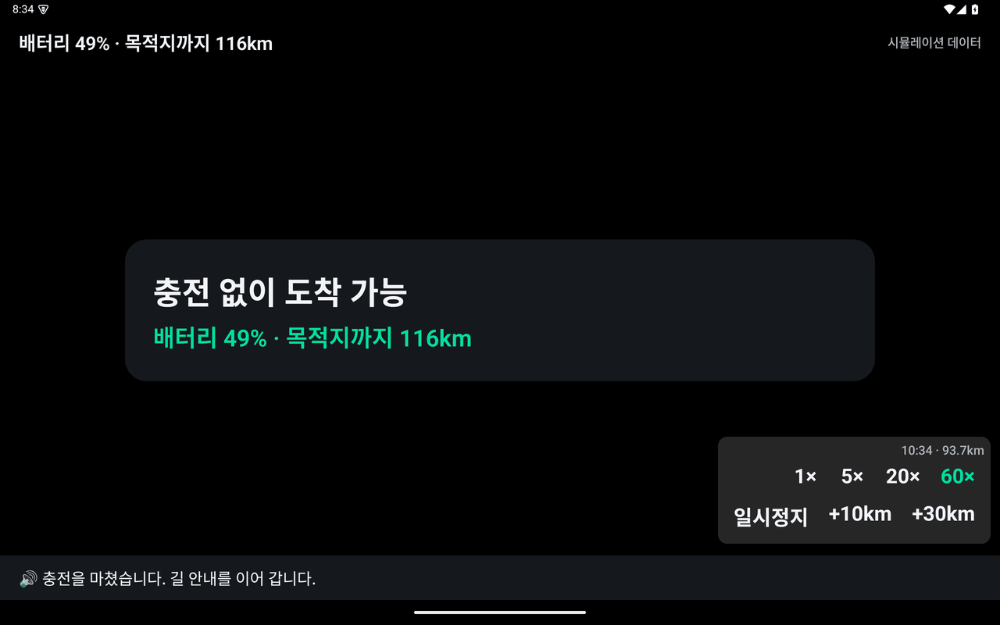

# Chargis (차지스)

> 전기차로 장거리를 갈 때 **"어느 휴게소에서, 몇 %까지, 얼마 동안"** 충전하면 되는지 차량 화면이 먼저 알려 주는 Pleos Connect용 휴게소 충전 비서 앱


현대자동차그룹 차량용 앱 개발 공모전 출품작입니다. 내비게이션 경로와 배터리 상태를 읽어 경로상 휴게소 충전소 가운데 1순위를 고르고, 목적지까지 필요한 만큼만 충전하라고 안내합니다. 충전기 시간 제한까지 챙겨 주므로 충전이 중간에 끊기지 않습니다.

---

## 왜 만들었나

명절이나 주말에 고속도로로 장거리를 가는 전기차 운전자는 매번 같은 고민을 합니다.

| 문제 | Chargis의 답 |
|---|---|
| 휴게소 충전기가 붐벼서 기다려야 한다 | 출력, 가용 대수, 예상 대기를 함께 비교해 **덜 붐비는 휴게소**를 고른다 |
| 시간 제한을 몰라서 충전이 중간에 끊긴다 | 충전을 시작할 때 **운영 규칙을 안내**하고, 제한 안에 목표에 닿을 수 있는지 미리 계산한다 |
| 몇 %까지 충전할지 판단하기 어렵다 | 목적지까지 필요한 에너지에 안전 마진을 더해 **"OO%까지만 충전"** 이라고 정해 준다 |
| 동승자가 언제 출발하는지 모른다 | 충전 화면에 **목표까지 남은 시간과 출발 예정 시각**을 크게 띄운다 |

기존 앱이 충전소의 **위치**를 알려 준다면, Chargis는 차량 데이터와 경로를 바탕으로 **얼마나, 얼마 동안** 충전할지를 계산해 먼저 안내합니다.

---

## 핵심 기능

| ID | 기능 | 설명 | 현재 상태 |
|---|---|---|---|
| F1 | 휴게소 충전소 추천 | 경로상 휴게소를 도착 시 배터리, 출력, 가용 대수, 대기 시간, 경로 이탈 거리로 점수를 매겨 1순위와 대안 2곳을 고른다 | ✅ 구현 |
| F2 | 목표 충전량 코치 | 목적지까지 필요한 SoC에 안전 마진을 더하고 5% 단위로 올려 "50%까지 충전"처럼 안내한다. 상한(80%)으로도 모자라면 추가 충전이 필요하다고 알린다 | ✅ 구현 |
| F3 | 충전 시간 제한 알림 | 충전을 시작하면 "40분 제한" 같은 운영 규칙을 안내하고, 목표까지 남은 시간과 제한까지 남은 시간을 보여 준다 | 🟡 일부 구현 (제한 10분·5분 전 알림은 예정) |
| F4 | 경유지 자동 추가 | 추천을 수락하면 해당 휴게소를 내비게이션 경유지로 등록하고 경로를 다시 탐색한다 | 🟡 데모용 Fake 내비로 동작 (SDK 연동 예정) |

이 밖에 다음 기능을 함께 제공합니다.

- **혼잡 대안 비교:** 1순위 휴게소의 대기 시간이 20분을 넘으면, 대안 휴게소와 "대기 시간 vs 도착 시 배터리"를 나란히 비교하는 카드를 띄웁니다.
- **음성 안내:** 모든 안내에 음성을 함께 냅니다. 같은 문장은 반복하지 않고, 이미 안내했거나 거절한 휴게소도 다시 안내하지 않습니다.
- **출처 표시:** 실시간 정보가 없으면 숨기지 않고 "정보 없음"으로 표시하고, 화면 상단에 데이터 출처(시뮬레이션, 직접 입력, 차량 데이터)를 표시합니다.

---

## 실제 사용 화면

아래 화면은 앱에 들어 있는 **S1 시나리오(가상의 서울→속초 경로, 출발 배터리 60%, 210km)** 를 처음부터 끝까지 실행하며 캡처한 것입니다.

> 📷 스크린샷은 일반 Android 에뮬레이터(태블릿, 가로 2560×1600)에서 찍었습니다. 오른쪽 아래 회색 패널은 데모 진행용 **개발자 오버레이**이며 릴리스 빌드에서는 보이지 않습니다. 휴게소 이름과 데이터는 모두 가상입니다.

### 1. 시나리오 선택 → 출발

| 시작 화면 | 주행 시작: 충전 계획 |
|---|---|
|  |  |
| 데모 시나리오 S1(기본)과 S2(명절 혼잡) 중 하나를 고릅니다. | 출발하자마자 경로와 배터리를 계산해 *"이번 이동은 중간 충전 1회가 필요합니다"* 라고 안내합니다. |

### 2. 주행 중 추천 → 수락 (F1·F2·F4)

| 추천 카드 | 경유지 안내 중 |
|---|---|
|  |  |
| 1순위 휴게소가 50km 안에 들어오면 한 번만 안내합니다. 주행 중에는 **카드 1장과 큰 버튼 2개(수락 / 다음 휴게소)** 만 보입니다. | [수락]을 누르면 B 휴게소를 경유지로 추가하고, 남은 거리와 목표 충전량만 보여 줍니다. |

### 3. 도착 → 충전 (F3)

| 휴게소 도착 | 충전 중 |
|---|---|
|  |  |
| 정차하면 바로 상세 화면으로 바뀝니다. 현재·목표 충전량, 예상 시간, 충전기 시간 제한, 다른 후보 비교 표를 보여 줍니다. | 동승자도 읽을 수 있게 **목표까지 남은 시간, 제한까지 남은 시간, 출발 예정 시각**을 크게 표시합니다. 충전을 시작하면 *"이 충전기는 40분 제한이 있습니다"* 라고 안내합니다. |

### 4. 충전 완료 → 재출발 → 도착

| 충전 완료 | 재출발 | 목적지 도착 |
|---|---|---|
|  |  |  |
| 목표(50%)에 도달하면 알리고 [출발] 버튼을 띄웁니다. | 다시 주행 카드로 돌아와 길 안내를 이어 갑니다. | 안전 마진 덕분에 배터리 19%를 남기고 도착합니다. |

### 5. 명절 혼잡 시나리오 (S2)


1순위 B 휴게소의 대기가 30분이면 대안인 C 휴게소와 **대기 시간과 도착 시 배터리**를 나란히 보여 줍니다. 운전자는 큰 버튼 하나로 바로 고를 수 있습니다.

---

## 어떻게 계산하나

추천 엔진은 안드로이드 의존이 없는 순수 Kotlin 코드이며([`ChargeMath`](app/src/main/java/com/chargis/app/domain/engine/ChargeMath.kt), [`RecommendationEngine`](app/src/main/java/com/chargis/app/domain/engine/RecommendationEngine.kt)), 단위 테스트로 검증합니다.

```
socPerKm          = (1 / 전비) / 배터리 용량 × 100              // 1km당 쓰는 배터리 %
도착 SoC          = 현재 SoC − 거리 × socPerKm
필요 SoC(거리)    = 거리 × socPerKm × (1 + 안전 마진 15%) + 최소 도착 잔량 10%
목표 충전량       = 필요 SoC를 5% 단위로 올림 (상한 80%)
충전 시간         = 80% 이하 구간: 출력 × 0.75로 충전, 80% 초과 구간: 그보다 더 느리게(× 0.35)
점수              = 도착 SoC·출력·가용 비율은 높을수록, 경로 이탈·대기 시간은 짧을수록 가산 (후보끼리 정규화)
```

기본 차종 프로필(77.4kWh, 5.0km/kWh, 최대 150kW)을 쓰면 S1에서 다음처럼 계산됩니다.

1. 210km를 가려면 72.4%가 필요한데 현재 60%라서 충전이 필요합니다.
2. 90km 지점의 B 휴게소에 도착하면 약 36.7%가 남습니다.
3. B 휴게소에서 목적지까지 남은 120km에는 45.7%가 필요하므로, **50%까지 충전**하라고 안내합니다.

모든 수치는 가정 기본값이며 [`RecommendationConfig`](app/src/main/java/com/chargis/app/domain/model/Models.kt)에서 조정합니다.

---

## 아키텍처

```
┌──────────────────────── UI (Jetpack Compose) ───────────────────────┐
│  DriveCardScreen (주행 중 카드 1장)     ParkedScreen (정차·충전 상세)   │
└──────────────────────────────▲───────────────────────────────────────┘
                               │ StateFlow<TripUiState>
                      ┌────────┴────────┐
                      │ TripController  │ ← 상태머신: Idle → Driving → AwaitingDecision
                      └────────┬────────┘   → NavigatingToCharger → Arrived → Charging → Done …
        ┌──────────────────────┼──────────────────────┐
        ▼                      ▼                      ▼
 RecommendationEngine    AnnouncementGate       VoiceAnnouncer
 ChargeMath (순수 Kotlin) (재안내 금지·히스테리시스)  (발화 순서·중복 방지)
        ▲
┌───────┴──────────────────── Ports (interface) ──────────────────────┐
│  NaviPort   VehiclePort   ChargerDataPort   TtsPort   LocationPort   │
└───────┬──────────────────────────────────────────────┬───────────────┘
   Fake* + ScenarioSimulator (현재)              Sdk* (Pleos Connect SDK 확보 후)
```

- **포트와 어댑터:** 도메인과 UI는 SDK나 네트워크 클래스를 직접 쓰지 않습니다. 구현체 선택은 [`AppContainer`](app/src/main/java/com/chargis/app/AppContainer.kt)에서만 합니다.
- **데모 시뮬레이터:** [`ScenarioSimulator`](app/src/main/java/com/chargis/app/sim/ScenarioSimulator.kt)가 가상 시계 하나로 모든 Fake 포트를 움직입니다. 같은 시나리오는 항상 같은 결과를 냅니다.
- **주행/정차 전환:** `VehicleState.isDriving` 값 하나로 화면이 즉시 바뀝니다. 주행 중에는 스크롤과 텍스트 입력이 없습니다.

```
app/src/main/java/com/chargis/app/
├─ domain/   model/ engine/ session/   # 도메인 모델, 추천 엔진, 상태머신
├─ port/                               # 외부 의존 인터페이스
├─ data/     fake/ sdk/ asset/         # Fake 구현, SDK 스텁, 번들 JSON 로더
├─ sim/                                # 데모 시나리오 시뮬레이터
├─ voice/                              # 음성 문구·발화 관리·TTS
└─ ui/       drive/ parked/ theme/     # Compose 화면
app/src/main/assets/                   # 가상 샘플 데이터(휴게소, 경로, 차종)
```

---

## 빌드와 실행

**필요한 것:** JDK 17, Android SDK(platform 36, build-tools), Android 9(API 28) 이상 기기 또는 에뮬레이터

```bash
./gradlew assembleDebug testDebugUnitTest
```

```bash
adb install -r app/build/outputs/apk/debug/app-debug.apk
```

- `local.properties`에 `sdk.dir`를 지정합니다. 이 파일은 커밋하지 않습니다.
- 외부 API 키가 필요해지면 `local.properties`에 넣어 `BuildConfig`로 주입합니다. 키가 없어도 번들 샘플 데이터로 모든 기능이 동작합니다.

**데모 조작(디버그 빌드):** 오른쪽 아래 개발자 오버레이에서 배속(1×/5×/20×/60×), 일시정지, +10km/+30km 점프를 쓸 수 있습니다. 60× 배속이면 S1 전체를 약 3분 안에 재현할 수 있습니다.

---

## 테스트

| 구분 | 내용 |
|---|---|
| 추천 엔진 (T1~T7) | 기본 추천, 시간 제한 위험, 충전 불필요, 안전한 휴게소 없음, 실시간 정보 없음, 혼잡 대안, 재안내 금지 |
| 충전 수식 | 충전 시간과 그 역함수(제한 시점 SoC), 80% 초과 감쇠 구간 |
| 상태머신 | 정상 흐름, 거절, 허용되지 않은 전이 |
| 시나리오 통합 | S1 전체(추천 → 수락 → 도착 → 충전 → 재출발 → 도착)의 상태 순서와 음성 순서, 거절 후 다음 후보, S2 혼잡 카드, 시뮬레이터 결정성 |

---

## 현재 한계와 다음 단계

- **SDK 미연동:** Pleos Connect SDK(NaviHelper, Vehicle, TextToSpeech)가 아직 없어 모든 데이터는 시뮬레이터에서 나옵니다. SDK를 받으면 포트 뒤의 `Sdk*` 어댑터만 구현하면 됩니다.
- **F3 알림 미완성:** 시간 제한 10분·5분 전 알림, 목표 5분 전 알림은 아직 구현하지 않았습니다(M3 예정).
- **실데이터 미연동:** 공공 충전소 데이터와 시간대별 혼잡 통계 연동, 설정 화면(상한·안전 마진·차종), 수동 SoC 입력은 아직 없습니다(M2 예정).
- **검증 환경:** 화면 확인은 일반 Android 에뮬레이터에서만 했습니다. Pleos Connect 에뮬레이터에서 다시 확인해야 합니다.

설계 결정과 가정은 [docs/DECISIONS.md](docs/DECISIONS.md)에, 확인이 필요한 항목은 [docs/OPEN_ISSUES.md](docs/OPEN_ISSUES.md)에, 전체 개발 계획은 [plan.md](plan.md)에 있습니다.

---

## 데이터와 개인정보

- 휴게소 이름(A~D 휴게소), 좌표, 경로는 모두 **가상 데이터**이며 실제 시설이나 사업자 상표를 쓰지 않습니다.
- 앱은 개인정보를 수집하거나 외부로 보내지 않습니다.
- 저장소를 공개하기 전에 [`scripts/check_privacy.sh`](scripts/check_privacy.sh)로 개인정보 문자열이 없는지 점검합니다.
